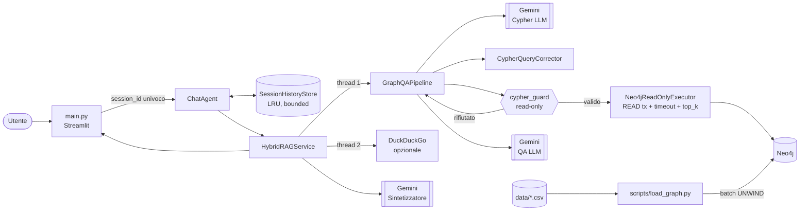
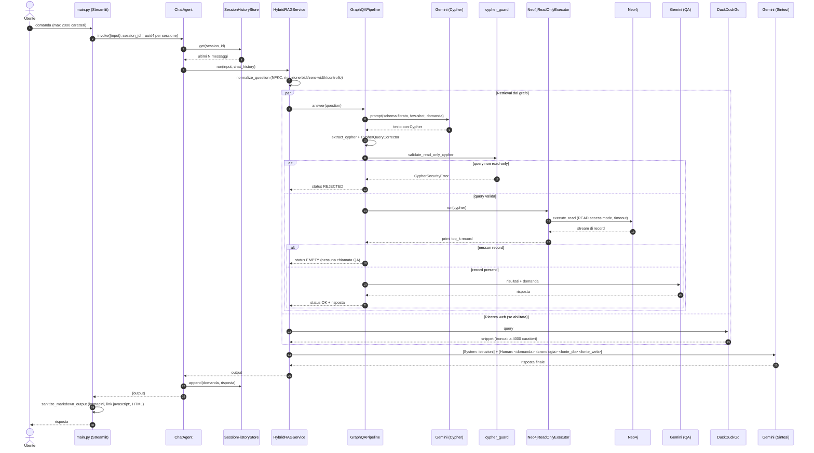

# Architecture Audit — GraphRAG Medical Chatbot

> Audit date: 2026-11-14 · Scope: all files tracked in the repository (`src/`, `openAI/`, `data/`, configuration)
> Companion documents: [`SECURITY_REPORT.md`](SECURITY_REPORT.md) · [`README.md`](README.md)

---

## 1. Logica di business

Il sistema è un chatbot di **Retrieval-Augmented Generation su grafo** per domande biomediche incentrate sul gene **BSG (Basigin / CD147)**.

1. L'utente pone una domanda in linguaggio naturale nella UI Streamlit.
2. Un LLM (Gemini) traduce la domanda in una query **Cypher**, guidato dallo schema del grafo (filtrato su 15 label biomediche + la relazione `REL`) e da 7 esempi few-shot.
3. La query viene eseguita su **Neo4j**; i record restituiti vengono riassunti da un secondo LLM ("QA") in una risposta testuale.
4. In parallelo viene eseguita una **ricerca web** (DuckDuckGo) sulla stessa domanda.
5. Un terzo LLM ("sintetizzatore") fonde le due fonti, con **priorità assoluta al database interno**, dichiarando esplicitamente la provenienza ("Secondo il nostro database…").
6. La risposta viene mostrata e memorizzata nella cronologia della sessione, usata per interpretare domande di follow-up.

### Il dataset (`data/`)

| File | Formato | Righe | Note |
|---|---|---|---|
| `nodes.csv` | TSV `neo4j-admin import` (`id:ID`, `label:LABEL`, `word`) | 830 | label multiple separate da `\|` (fino a 7 per nodo) |
| `edges.csv` | TSV (`src:START_ID`, `dst:END_ID`, `type:TYPE`, `verb`) | 2 728 | unico tipo `REL`; il verbo estratto dal testo è in `verb` |

Profilo rilevato durante l'audit:

* label più frequenti: `chemical_entity` (223), `chemical` (196), `gene` (187), `disease` (164), `protein` (157);
* nodo hub: `house mouse` (id 1) con **778 relazioni**; seguono `Bsg` (id 0) e il nodo 36;
* **105 self-loop**, 0 archi pendenti, 0 duplicati;
* **tutti i 830 valori `word` sono racchiusi tra backtick** (`` `Bsg` ``): importati così come sono, i filtri dei few-shot `lower(g.word) = lower("BSG")` non trovano **mai** corrispondenze (vedi TD-01);
* valori Unicode presenti (es. `aldehydo-D-(¹³C₆)glucose`, testo persiano).

---

## 2. Architettura

### 2.1 Prima del refactoring

```
src/main.py ──import──▶ graph_rag_agent.py ──import──▶ graphRag_cypher_chain_cd.py
   (UI)                 (connette DDG + Gemini           (connette Neo4j, legge lo schema,
                         all'import)                       crea GraphCypherQAChain all'import
                                                           con allow_dangerous_requests=True)
```

Tutto il wiring avveniva come **side-effect dell'import**: impossibile importare un modulo senza credenziali valide e un Neo4j attivo, quindi nessun test era possibile.

### 2.2 Dopo il refactoring

```
src/
├── main.py                      UI Streamlit (sottile: sessione, rendering, errori generici)
├── graph_rag_agent.py           shim retro-compatibile, costruzione lazy dell'agente
├── graphRag_cypher_chain_cd.py  shim retro-compatibile, costruzione lazy della pipeline
└── graphrag/
    ├── config.py        Settings immutabili e validate (URI, limiti, toggle web)
    ├── cypher_guard.py  validatore statico read-only per Cypher generato dall'LLM
    ├── executor.py      esecuzione in transazione READ, timeout, streaming limitato
    ├── graph_qa.py      pipeline NL → Cypher → record → risposta, con stati tipizzati
    ├── hybrid.py        retrieval grafo + web in parallelo, sintesi anti-injection
    ├── memory.py        cronologia per sessione, limitata (LRU) e thread-safe
    ├── sanitize.py      normalizzazione input, sanitizzazione output Markdown
    ├── prompts.py       template e vocabolario consentito
    ├── loader.py        import sicuro del dataset CSV (batch UNWIND)
    └── factory.py       unico punto che crea client reali (Neo4j, Gemini, DDG)
scripts/load_graph.py    CLI per caricare data/*.csv in Neo4j
openAI/                  variante legacy, ora appoggiata sulla stessa pipeline protetta
```

Principi applicati:

| Principio | Applicazione |
|---|---|
| **S**ingle responsibility | validazione, esecuzione, orchestrazione, memoria, UI e wiring sono moduli distinti |
| **O**pen/closed | nuovi provider LLM tramite `llm_factory` (es. `openai_llm_factory`) senza toccare la pipeline |
| **L**iskov / **I**nterface segregation | `CypherExecutor` è un `Protocol` minimo (`run`); fake e reale sono intercambiabili |
| **D**ependency inversion | `GraphQAPipeline` e `HybridRAGService` ricevono LLM, executor e web search per injection |
| Clean code | niente side-effect all'import, stati `GraphQAStatus` invece di confronti tra stringhe, errori loggati e non mostrati |

### 2.3 Componenti e dipendenze



Dipendenze runtime (vedi `requirements.txt`): `streamlit`, `langchain-core`, `langchain-community` (solo per `DuckDuckGoSearchRun`), `langchain-neo4j`, `langchain-google-genai`, `neo4j`, `python-dotenv`, `ddgs`/`duckduckgo-search`.

### 2.4 Sequenza di una richiesta



---

## 3. Colli di bottiglia delle prestazioni

| ID | Problema (prima) | Impatto | Intervento | Stato |
|---|---|---|---|---|
| PERF-01 | Retrieval dal grafo e ricerca web eseguiti **in sequenza** | latenza = somma delle due (tipicamente 2–6 s + 1–3 s) | `ThreadPoolExecutor` condiviso: latenza = **massimo** delle due | ✅ Risolto |
| PERF-02 | `graph.query(cypher)[:top_k]`: **tutti** i record materializzati in memoria e poi tagliati | O(N) memoria e trasferimento per query senza `LIMIT` (es. `MATCH p=()-[*]-() RETURN p`) | streaming con interruzione dopo `top_k` record | ✅ Risolto |
| PERF-03 | Nessun timeout sulle query | query patologiche (prodotti cartesiani, path variabili non limitati) occupano il DB senza fine | timeout lato server via `unit_of_work(timeout=…)` | ✅ Risolto |
| PERF-04 | Chiamata al QA-LLM anche con risultati vuoti | un round-trip LLM sprecato (~0,5–1,5 s e costo) per ogni domanda senza risposta | stato `EMPTY` → QA-LLM saltato | ✅ Risolto |
| PERF-05 | Introspezione dello schema due volte all'avvio (costruttore + `refresh_schema()` esplicito) e filtro manuale poi **sovrascritto** | doppia `apoc.meta.data()`, codice morto | una sola introspezione; filtro via `construct_schema(include_types)` | ✅ Risolto |
| PERF-06 | Memoria chat in un `dict` globale, mai svuotato, con un'unica sessione condivisa | crescita illimitata della memoria del processo | LRU su sessioni (`max_sessions`) e messaggi (`max_messages`) | ✅ Risolto |
| PERF-07 | Contenuto web e contesto QA senza limite di dimensione | prompt enormi → latenza, costi, errori di context window | troncamento (`web_max_chars`, `max_context_chars`) | ✅ Risolto |
| PERF-08 | Filtri `lower(x.word) CONTAINS …` nei few-shot | full label scan, nessun indice utilizzabile | consigliato un indice full-text (`CREATE FULLTEXT INDEX word_ft FOR (n:gene\|disease\|protein) ON EACH [n.word]`) o una proprietà `word_lower` indicizzata | 🟡 Aperto (richiede modifica dello schema dati) |
| PERF-09 | Tre chiamate LLM sequenziali per domanda (Cypher → QA → sintesi) | latenza dominata dagli LLM | QA e sintesi potrebbero essere fuse in una sola chiamata; non fatto per non alterare il comportamento | 🟡 Aperto |
| PERF-10 | Import con `UNWIND` assente (nessun loader) | — | `loader.py`: batch da 500 righe, una transazione per batch, lookup per `elementId` (nessuna N+1 per arco) | ✅ Aggiunto |

> Nota "N+1": il codice applicativo non contiene query N+1 (una sola query per domanda). Il pattern era invece implicito nella procedura di import (assente); il nuovo loader usa un round-trip per batch, non per riga.

---

## 4. Debito tecnico

| ID | Descrizione | Gravità | Stato |
|---|---|---|---|
| TD-01 | Valori `word` con backtick letterali nel CSV: con `neo4j-admin import` diretto le uguaglianze dei few-shot non trovano mai corrispondenze | Alta (correttezza) | ✅ Il loader rimuove i backtick; verificato su Neo4j reale |
| TD-02 | Wiring con side-effect all'import (Neo4j, Gemini, DDG) → codice non testabile | Alta | ✅ Factory + shim lazy (PEP 562 `__getattr__`) |
| TD-03 | Filtro dello schema calcolato e poi **annullato** da `graph.refresh_schema()` (codice morto che sembrava funzionare) | Media | ✅ Rimosso; filtro tramite `construct_schema` |
| TD-04 | La cronologia chat veniva salvata ma **mai passata al prompt**: i follow-up promessi dal README non funzionavano | Media | ✅ Ultimi N messaggi inclusi (delimitati) nel prompt di sintesi |
| TD-05 | Modello del sintetizzatore hardcoded (`GRAPHRAG_AGENT_MODEL` ignorata) | Bassa | ✅ Letto da `Settings` |
| TD-06 | Rilevamento "nessuna risposta" via `"don't know" in str(output)` | Media | ✅ Stati tipizzati (`OK/EMPTY/REJECTED/ERROR`); marcatore testuale mantenuto solo come fallback |
| TD-07 | Mix `langchain_community.graphs.Neo4jGraph` (deprecato) + `langchain_neo4j.GraphCypherQAChain` | Media | ✅ Solo `langchain_neo4j` |
| TD-08 | `RunnableWithMessageHistory` deprecato in langchain-core 1.x | Bassa | ✅ Sostituito da `ChatAgent` (stessa interfaccia `invoke`) |
| TD-09 | Nessun `requirements.txt`, nessun test, README con file inesistenti (`start_demo.sh`, `main_3.py`) | Media | ✅ `requirements*.txt`, `pyproject.toml`, 454 test, README aggiornato |
| TD-10 | Variante `openAI/`: importava il modulo Gemini, API LangChain rimosse, `hub.pull` remoto | Media | ✅ Allineata alla pipeline protetta; prompt locale; resta "legacy" e non coperta da test (richiede `langchain-openai`) |
| TD-11 | `.env.example` con URL GitHub `/blob/` (pagine HTML, non CSV) | Bassa | ✅ Percorsi locali; `resolve_csv_source` converte gli URL `/blob/` in `raw` |
| TD-12 | `langchain-community` in dismissione (usato solo per `DuckDuckGoSearchRun`) | Bassa | 🟡 Aperto: migrare a `ddgs` diretto o a un pacchetto di integrazione dedicato |
| TD-13 | 105 self-loop e un hub (`house mouse`, 778 archi) che domina i path brevi | Bassa (qualità dati) | 🟡 Aperto: valutare il filtraggio in fase di estrazione |
| TD-14 | Nessuna autenticazione né rate limiting sulla UI | Media | 🟡 Aperto (vedi SECURITY_REPORT, SEC-10) |

---

## 5. Strategia di test

| Livello | File | Cosa copre |
|---|---|---|
| Unit | `tests/unit/test_cypher_guard.py` | 74 casi da `fixtures/cypher_cases.json` (30 legittimi, 44 malevoli) + casi limite di lexing |
| Unit | `tests/unit/test_graph_qa.py` | tutti gli stati della pipeline, injection mai eseguite, errori senza leak |
| Unit | `tests/unit/test_hybrid.py` | concorrenza reale (barrier), timeout, fencing, cronologia, fallimenti |
| Unit | `tests/unit/test_sanitize.py` | 54 domande da `fixtures/user_questions.json` (Unicode, bidi, zero-width, payload, lunghezze estreme) |
| Unit | `test_config.py`, `test_memory.py`, `test_loader_and_executor.py` | validazione, LRU + thread safety, parsing CSV, executor con driver mock |
| Integration | `tests/integration/test_agent_flow.py` | agente completo con LLM fake, isolamento sessioni, shim legacy |
| Integration | `tests/integration/test_streamlit_app.py` | `main.py` reale via `streamlit.testing.AppTest` |
| Integration | `tests/integration/test_neo4j_live.py` | Neo4j 5.26 + APOC in Docker: carica il dataset reale, verifica che il DB rifiuti le scritture **anche aggirando il guard**, timeout, introspezione dello schema reale |

Risultato: **454 test superati, 0 falliti, 0 saltati, 0 warning** (anche con `-W error::DeprecationWarning`), coverage del package `graphrag` **98 %** (branch coverage attiva).
