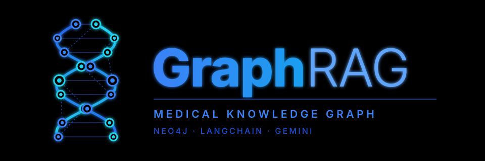
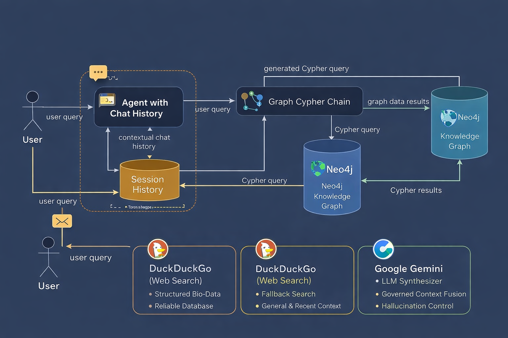
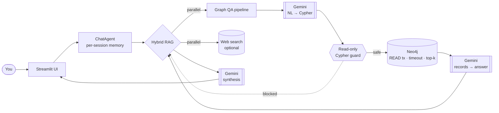

<p align="center">
  
</p>

<p align="center">
  <b>Ask questions in plain language. Get answers grounded in a biomedical knowledge graph.</b><br>
  Graph-based Retrieval-Augmented Generation over Neo4j, powered by Google Gemini.
</p>

<p align="center">
  
  
  
  
  <br>
  
  
  
</p>

<p align="center">
  <a href="#-quick-start">Quick start</a> ·
  <a href="#-how-it-works">How it works</a> ·
  <a href="#-security-by-design">Security</a> ·
  <a href="#-testing">Testing</a> ·
  <a href="ARCHITECTURE_AUDIT.md">Architecture audit</a> ·
  <a href="SECURITY_REPORT.md">Security report</a>
</p>

---

## 🧬 What is it?

**GraphRAG Medical Chatbot** answers complex biological questions about the **BSG gene (Basigin / CD147)**: its diseases, proteins, drugs, pathways and tissues.

Classic RAG pipelines retrieve *similar text chunks*. GraphRAG retrieves *facts and relationships*: the LLM turns your question into a **Cypher query**, runs it on a **Neo4j knowledge graph**, and writes the answer from the actual graph records. Every claim is labelled with its source, the internal database or the web.

```text
You  ▸ Which drugs target genes associated with diabetes?
Bot  ▸ According to our database, the following drugs target genes linked to
       diabetes: … (graph) — Additional context from the web: … (web)
```

<p align="center">
  
</p>

## ✨ Highlights

| | |
|---|---|
| 🔗 **Graph-grounded answers** | Natural language → Cypher → Neo4j records → answer. Few-shot prompts tuned on the real schema. |
| ⚡ **Hybrid & parallel retrieval** | Graph lookup and (optional) DuckDuckGo search run **concurrently**; the database always has priority. |
| 💬 **Conversational memory** | Per-user, bounded chat history makes follow-up questions work ("…and in which tissues?"). |
| 🛡️ **Read-only by construction** | Generated Cypher is statically validated **and** executed in a READ transaction with a timeout. |
| 🧪 **454 tests, 98 % coverage** | Unit, Streamlit UI and live Neo4j-in-Docker integration tests, on a 128-record adversarial dataset. |
| 🔌 **Provider-agnostic core** | Swap Gemini for another chat model by passing a different `llm_factory` (an OpenAI variant ships in `openAI/`). |

## 🧠 How it works



1. **Normalise** the question (Unicode NFKC; control, zero-width and bidi characters removed; length capped).
2. **Generate Cypher** from the filtered graph schema and 7 domain few-shot examples.
3. **Correct and validate**: relationship directions are fixed against the schema, and anything that is not a single read-only statement is rejected.
4. **Execute** in a Neo4j READ transaction, streaming at most `top_k` records with a server-side timeout.
5. **Summarise** the records. If no records come back, the extra LLM call is skipped.
6. **Synthesise** the graph and web sources. Instructions and untrusted data are kept in separate, delimited messages.
7. **Render safely**: images, `javascript:` links and raw HTML are stripped from the output.

Full sequence diagram, bottleneck analysis and technical-debt log: **[ARCHITECTURE_AUDIT.md](ARCHITECTURE_AUDIT.md)**.

## 🗂️ The knowledge graph

| | |
|---|---|
| **Nodes** | 830 entities, with up to 7 labels each: `gene`, `protein`, `disease`, `drug`, `compound`, `chemical_entity`, `biological_pathway`, `tissue`, `symptom`, … |
| **Relationships** | 2 728 `REL` edges, each carrying the extracted `verb` ("was revealed", "reduced", …) |
| **Format** | Tab-separated `neo4j-admin` import format in [`data/`](data/) |

## 🚀 Quick start

### 1 · Clone & install

```bash
git clone https://github.com/Ciccio1307/GraphRAG.git
cd GraphRAG
python3 -m venv .venv && source .venv/bin/activate   # Windows: .venv\Scripts\activate
pip install -r requirements.txt
```

### 2 · Start Neo4j (with APOC, needed for schema introspection)

```bash
docker run -d --name graphrag-neo4j -p 7474:7474 -p 7687:7687 \
  -e NEO4J_AUTH=neo4j/change-me-please \
  -e NEO4J_PLUGINS='["apoc"]' \
  neo4j:5.26-community
```

> AuraDB works too: use its `neo4j+s://…` URI.

### 3 · Configure

```bash
cp .env.example .env    # then fill in GOOGLE_API_KEY and the NEO4J_* values
```

### 4 · Load the dataset

```bash
python scripts/load_graph.py          # add --wipe to reload into a non-empty database
# → Loaded 830 nodes and 2728 relationships.
```

### 5 · Chat 🎉

```bash
streamlit run src/main.py             # or: ./src/entrypoint.sh
```

Try questions such as:

- *What diseases are related to the BSG gene?*
- *Which proteins interact with BSG?*
- *Find drugs that target genes associated with diabetes*
- *In which tissues is BSG expressed?*

## ⚙️ Configuration

| Variable | Default | Description |
|---|---|---|
| `GOOGLE_API_KEY` | — | Gemini API key ([Google AI Studio](https://aistudio.google.com/app/apikey)) |
| `NEO4J_URI` / `NEO4J_USER` / `NEO4J_PASSWORD` | — | Connection (`bolt`, `bolt+s`, `neo4j`, `neo4j+s`, …) |
| `NEO4J_DATABASE` | server default | Target database |
| `GRAPHRAG_CYPHER_MODEL` / `GRAPHRAG_QA_MODEL` / `GRAPHRAG_AGENT_MODEL` | `models/gemini-2.5-flash-lite` | Model for each pipeline stage |
| `GRAPHRAG_TOP_K` | `100` | Max records read per query |
| `GRAPHRAG_QUERY_TIMEOUT_S` | `15` | Server-side query timeout |
| `GRAPHRAG_MAX_QUESTION_CHARS` | `2000` | Input length limit |
| `GRAPHRAG_MAX_HISTORY_MESSAGES` / `GRAPHRAG_MAX_SESSIONS` | `20` / `1000` | Memory bounds |
| `GRAPHRAG_ENABLE_WEB_SEARCH` | `true` | Set to `false` to keep questions away from third-party search |
| `GRAPHRAG_WEB_MAX_CHARS` | `4000` | Web context size cap |

> 🔐 Never commit `.env`; it is git-ignored.

## 🛡️ Security by design

The Cypher sent to the database is written by an LLM from user input, so the app treats it as **untrusted code**:

| Layer | Protection |
|---|---|
| 1 · Static guard | Literal- and comment-aware validation blocks `CREATE`, `MERGE`, `DELETE`, `SET`, `LOAD CSV`, `apoc.*`, `dbms.*`, multi-statements and non-allowlisted `CALL`s |
| 2 · Database | Queries run in a **READ** transaction; Neo4j itself refuses writes even if layer 1 were bypassed (verified in tests) |
| 3 · Resources | Server-side timeout, streamed `top_k` limit, bounded memory and input size |
| 4 · LLM I/O | Untrusted data fenced off from instructions; Markdown output sanitised against exfiltration beacons |
| 5 · Sessions | Random per-browser session ids, so conversations are never shared between users |

For production, also connect with a Neo4j user that has only the built-in **`reader`** role. Findings, payloads and the hardening checklist are in **[SECURITY_REPORT.md](SECURITY_REPORT.md)**.

## 🧪 Testing

```bash
pip install -r requirements-dev.txt
pytest                      # unit + Streamlit + integration
pytest --cov                # with coverage report
pytest -m "not neo4j"       # skip the live-database tests
```

The live tests start a throw-away `neo4j:5.26-community` container automatically, or use `NEO4J_TEST_URI` / `NEO4J_TEST_USER` / `NEO4J_TEST_PASSWORD` if set. They load the real dataset and check read-only enforcement on an actual server.

| Suite | Covers |
|---|---|
| `tests/unit` | Cypher guard (74 benign and malicious queries), pipeline states, hybrid concurrency and timeouts, config validation, memory LRU and thread safety, sanitisation (54 edge-case questions), loader, executor |
| `tests/integration` | End-to-end agent flow, the real Streamlit app via `AppTest`, Neo4j + APOC in Docker |

## 📁 Project structure

```text
GraphRAG/
├── src/
│   ├── main.py                     # Streamlit UI
│   ├── graph_rag_agent.py          # lazy agent entry point (backwards compatible)
│   ├── graphRag_cypher_chain_cd.py # lazy graph-QA entry point (backwards compatible)
│   └── graphrag/                   # core package
│       ├── config.py  cypher_guard.py  executor.py  graph_qa.py
│       ├── hybrid.py  memory.py  sanitize.py  prompts.py
│       └── loader.py  factory.py
├── scripts/load_graph.py           # CSV → Neo4j loader
├── data/                           # nodes.csv, edges.csv
├── tests/                          # unit, integration, fixtures (adversarial datasets)
├── openAI/                         # legacy OpenAI variant (same hardened pipeline)
├── assets/logo.svg
├── ARCHITECTURE_AUDIT.md
└── SECURITY_REPORT.md
```

## 🗺️ Roadmap

- [ ] Full-text index on `word` to speed up `CONTAINS` lookups
- [ ] Merge the QA and synthesis LLM calls to cut latency
- [ ] Authentication and rate limiting in front of the UI
- [ ] Graph visualisation of the records behind each answer

---

<p align="center">
  <sub>Built with Neo4j · LangChain · Google Gemini · Streamlit</sub>
</p>
